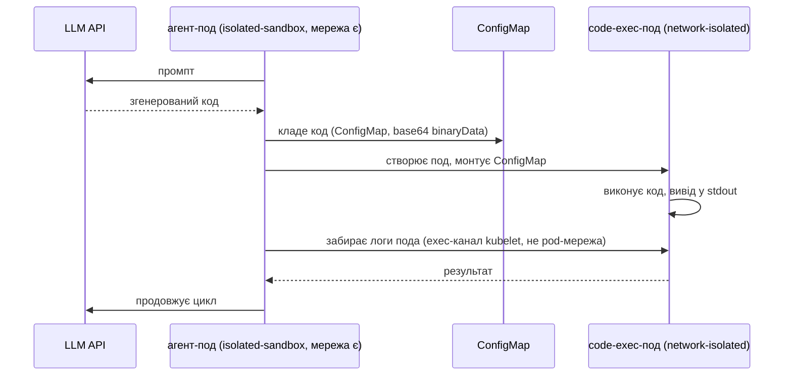

# ARTICLE-UK.md (чернетка, українська версія ARTICLE.md)

<!--
Статус: DRAFT 3 (11 листопада 2026), для CB Speed Run 2 (сабміт 16–23 листопада).
Числа в тексті з реальних прогонів, докази в evidence/ і benchmark-results.csv.
Перед сабмітом: підставити лінк на анонс, лінк на репо, цифру Auto Mode fee.
-->

# AI-агенти в апаратній ізоляції на EKS з Nitro Sandboxes: гайд з порівнянням із gVisor

Ти даєш AI-агенту писати код. Цей код вийшов з моделі, яка читає інтернет, і довіряти йому не можна. Тому середовище виконання мусить мати справжню межу ізоляції. 9 листопада 2026 AWS випустила такий інструмент: [Nitro Sandboxes](TODO-лінк-на-анонс), легкі VM під управлінням Nitro Hypervisor. Вони працюють для подів EKS, тасків ECS і окремих VM на EC2, без додаткової плати.

Тут я показую, як це працювало в мене на практиці: кластер, де Nitro Sandboxes, gVisor і звичайний runc бігають поруч на однакових інстансах, патерн «агент виконує код в ізольованому поді» від початку до кінця, і заміри, скільки ізоляція коштує в часі старту і щільності.

## Три рівні ізоляції на тому самому інстансі

Візьми один `m8i.xlarge` трьома способами, і різниця видна в `uname -r` всередині пода:

| Рантайм | Межа | Ядро, яке бачить под |
|---|---|---|
| runc (дефолт) | namespaces, cgroups | хост-ядро (AL2023) |
| [gVisor](https://gvisor.dev) через `runsc` | перехоплення системних викликів у юзерспейсі | синтетичне ядро, Sentry |
| Nitro Sandbox | апаратна VM під Nitro Hypervisor | власне гостьове ядро |

Про gVisor коротко: він перереалізовує Linux-ядро в процесі юзерспейсу. Звучить як трюк, але працює добре і на будь-якому типі інстансів.

Nitro Sandbox організований інакше. Кожен под стає мікро-VM так само, як функція Lambda: контейнер пода живе всередині VM з власним ядром, запущеної на тому ж EC2-інстансі, який ти вже орендуєш. З цього йдуть два наслідки:

1. Секрети можна віддавати тільки пісочницям, які довели свою цілісність. Виміри пісочниці живуть у PCR-регістрах, а key policy в KMS з умовами `kms:RecipientAttestation:PCR` віддає ключі розшифрування тільки при збігу. Але є проблема прямо з доків: без такої key policy (або іншого верифікатора) вимір записується, а ніколи не перевіряється. Для регульованих навантажень і для випадків, коли агент тримає креденшели, це критична деталь.
2. Межа ізоляції апаратна. Та сама, яку AWS ставить між твоїми інстансами і між Lambda-навантаженням та хостом.

Старий шлях до «справжньої VM всередині пода»: Kata Containers на nested virtualization. Він працює досі, але тепер зі зірочкою. Nested virtualization є тільки на Intel 8-го покоління (c8i/m8i/r8i), на Graviton її немає, і атестації теж немає. Nitro Sandboxes знімають усі три обмеження.

## Розгортання кластера

EKS Auto Mode з Kubernetes 1.36 чи новішим, і вмикання Nitro Sandboxes для пода виглядає так:

```yaml
spec:
  runtimeClassName: isolated-sandbox
```

Решта пода лишається нативною: Pod Identity, VPC CNI, EBS/EFS/S3, CloudWatch працюють як звично.

Мій кластер ([весь Terraform тут](TODO-лінк-на-репо)), один Auto Mode кластер з NodePool, прибитим до `m8i.xlarge`, плюс gVisor на managed node group того ж типу інстансу:

```yaml
# Auto Mode NodePool для Nitro Sandbox-подів
apiVersion: karpenter.sh/v1
kind: NodePool
metadata:
  name: sandbox-nitro
spec:
  template:
    metadata:
      labels: { sandbox-runtime: nitro }
    spec:
      taints:
        - { key: sandbox, value: nitro, effect: NoSchedule }
      requirements:
        - key: eks.amazonaws.com/instance-family
          operator: In
          values: ["m8i"]
```

```yaml
# Один із чотирьох smoke-тестових подів
apiVersion: v1
kind: Pod
metadata:
  name: nitro-codeexec
  annotations:
    sandbox.amazonaws.com/network-isolated: "true"   # мережевого пристрою немає взагалі
spec:
  runtimeClassName: isolated-sandbox
  nodeSelector: { sandbox-runtime: nitro }
  tolerations:
    - { key: sandbox, operator: Equal, value: nitro, effect: NoSchedule }
```

Два моменти, на яких поїдеш:

- Поди без toleration taint'а і nodeSelector їдуть на стандартний рантайм. Ізоляція opt-in, на рівні пода, а не кластера.
- Анотація `network-isolated` забирає в пода мережевий пристрій цілком: без DNS, без IMDS, без креденшелів Pod Identity. Побічний ефект: HTTP- і TCP-проби перестають працювати, тож такі поди беруть лише exec-проби. `kubectl port-forward` до такого пода не достукається зовсім; логи, exec і статистика живуть через vsock-канал, він не залежить від pod-мережі.

Повне розгортання на дефолтному VPC зайняло близько 20 хвилин у `terraform apply` (31 ресурс: приватні сабнети, NAT gateway, кластер, аддони, дві нодгрупи). Цікаве живе в трьох файлах: NodePool вище, `RuntimeClass` для gVisor і NodeConfig, який вчить containerd про `runsc` і ставить gVisor при буті ноди.

Після розгортання чотири probe-поди підтвердили таблицю: runc надрукував хост-ядро (`6.18.56`, спільне з нодою), Nitro Sandbox-под, інше гостьове ядро (`6.18.54`) і рівно запитані vCPU, network-isolated-под бачив тільки `lo` і мертвий DNS (`wget: bad address`, далі `NETWORK: blocked`), под на gVisor показав ядро Sentry (`4.19.0-gvisor`). Повні виводи лежать в репо, `evidence/runtime-evidence.txt`.

## Патерн: агент з мережею, код без неї

Схема має дві ролі:



Агент-под зберігає мережу: він говорить з API моделі і з Kubernetes API. Код їде в окремому поді без мережевого пристрою, без Pod Identity і без SA-токена. Вони не мають спільного сокета, тільки API-об'єкти.

Три місця реалізації, де я витратив найбільше часу:

**emptyDir не підходить, двома різними способами.** Він pod-скиповний, тож дві поди не можуть ним поділитися. А два контейнери в одній поді теж не рятують: анотація `network-isolated` pod-рівнева, і агент втратив би і свою мережу. Тому обмін іде через API-сервер.

**Код передається як base64 у `binaryData`.** Kubernetes монтує `binaryData` як декодовані байти, і в shell це нуль екранування JSON. У скрипті агента немає ані kubectl, ані jq всередині sandbox VM; сирі REST-виклики curl'ом через SA-токен і CA, які kubelet монтує сам, працюють нормально. Вся залежність: alpine і `apk add curl`.

**code-exec-под не монтує SA взагалі.** Став `automountServiceAccountToken: false`. Тоді згенерований код не має права дзвонити в Kubernetes API, створювати поди, читати секрети, навіть без мережі. RBAC навколо агента обмежений його namespace: створювати і видаляти поди та ConfigMaps у своєму namespace, читати логи подів, і нічого більше.

Повний цикл агента поміщається в один скрипт у ConfigMap і один pod spec; маніфест [тут](TODO-лінк-на-репо). У демо згенерований код перевіряє власну ізоляцію. Він виконався до кінця в network-isolated поді і надрукував:

```
kernel: 6.18.54
interfaces: dummy0 lo
wget: bad address 'aws.amazon.com'
NETWORK: blocked — isolation works
SA token: absent — expected
uid: 0
```

Три речі з цього розділу підтвердились на живому кластері: ConfigMap монтується всередині sandbox VM, exec і логи kubelet працюють без мережевого пристрою, SA-токен відсутній з `automountServiceAccountToken: false`.

## Скільки коштує ізоляція

Метод. Для cold start: N подів кожного рантайму, час від `kubectl apply` до Ready, по поду від `creationTimestamp` до Ready-кондишини, плюс wall time. Прогін двічі, перший включає бутстрап ноди. Для щільності: аплаю 1-vCPU `sleep`-поди доки Ready не перестає рости. Один нюанс методології, знайдений на практиці: планувальник пакує поди за CPU *запитом*, тож щоб дістатись до бюджету слотів пісочниці, я ставив запит 250m при ліміти 1 vCPU. При повному запиті 1 vCPU бюджет слотів навіть не дивиться (видно було живцем: один под на зайнятій ноді, де smoke-поди вже тримали vCPU).

| Метрика | runc | Nitro Sandbox | gVisor |
|---|---|---|---|
| Cold start на теплі ноді, per pod | 1-5 с (9 прогонів) | 3-4 с найкраще, 37 с p90 | n/a, цензуровано |
| Щільність: поди на m8i.xlarge | 3-4 | 15 Ready із ліміта слотів 20 | 2 |
| Вартість ноди на под-годину | ~$0.07 | ~$0.02 | ~$0.12 |

Що можна очікувати у свому прогоні:

- Щільність. З доків тут все явне. На ноду діють два обмеження, обидва = 5× кількість vCPU ноди: сумарні vCPU, розподілені між усіма sandbox'ами, і кількість самих sandbox'ів (ліміт кількості вдвічі менший на CPU-overcommit типах). На 4-vCPU `m8i.xlarge` це до 20 sandbox'ів по 1 vCPU. Кожен sandbox-под несе фіксований memory overhead, який планувальник додає зверх запиту пода: 256 MiB для `isolated-sandbox`, 512 MiB для `confidential-sandbox`. І на SMT-інстансах (всі Intel, більшість AMD) core scheduling не пускає два різні sandbox'и на сусідні потоки одного ядра, тож обчислень, доступних sandbox-подам, приблизно половина від задекларованих vCPU; Graviton (потік на ядро) не зачеплений. На моєму прогоні пам'ять вперлась раніше: 15 подів по 512 Mi + 256 Mi overhead влізло в 14.4 GiB allocatable, і 5 із 20 залишились у Pending. У gVisor цих обмежень немає, тож точка перетину: де щільність перемагає міцність межі.
- Вартість. Auto Mode бере плату менеджменту поверх EC2, якої немає в managed node groups. Для чесної под-години її рахувати окремим рядком (у моїй цифрі її поки немає, звірю з білінгом перед сабмітом). NAT для приватних сабнетів ≈ $0.045/год, і він тікає навіть без трафіку, тож демо знеси одразу після прогону.

## Холодний старт: два числа, а не одне

Перший прогін навчив більше, ніж видно з CLI. Час пода до Ready розпадається на дві незалежні частини, і вони міряють різні ризики.

**Старт пісочниці на ноді з вільними слотами.** Тепла нода приводить под до Ready за 3–37 с (runc: 1–5 с). Це чесна вартість самої ізоляції: image pull, бут VM, ініт гостьового ядра.

**Провіженінг ноди.** Под, що не вліз, попадає в рішення планувальника. Коли він номінує новий nodeclaim, EC2 спершу піднімає ноду, і це 1–3 хвилини буту AMI з kubelet join'ом, поки хоч один под зрушить. Перша хвиля в мене замірилась 215 с wall, а теплий прогін того ж spec: 5 с. Різниця в бутстрапі ноди, не в пісочниці.

І може стати значно гірше з причини, не пов'язаної з пісочницями. Мій аккаунт уперся в VcpuLimitExceeded по on-demand сімейству: дефолтний ліміт на свіжому аккаунті 32 vCPU на сімейство. Сім нод m8i.xlarge по 4 vCPU плюс system-нода заповнили бакет, і кожен новий nodeclaim ретраївся з `InsufficientCapacityError`, поки поди сиділи в Pending пів години, доки я не звільнив місію. Якщо повторюєш: перед density-експериментами підніми сімейство-ліміт vCPU або видали nodeclaims, що більше не потрібні.

Практичний висновок для методології: міряй вартість пісочниці на теплих нодах, а «з нуля до біжучого» окремим холодним шляхом разом з бутстрапом ноди. Не зливай докупи: вони інакше масштабуються і інакше ламаються.

## Де це не підходить

- GPU passthrough поки немає. Локальний inference всередині Nitro Sandbox сьогодні неможливий (пісочниця на Firecracker, пристрої не пробрасує). Агенту з локальною моделлю залишається API, або gVisor, який успадковує GPU хоста.
- Ні resize, ні snapshot. CPU і пам'ять виділяються при старті пода: in-place resize не підтримується, зміна означає видалити і перестворити под з новими запитами. Snapshot/restore і live migration теж відсутні, тож idle-агенти продовжують платити за ресурси.
- Привілеї самого агента: справжній ризик. Згенерований код у цьому патерні добре огороджений: без мережі, без токена, без API. Але агент-под тримає create-pods у своєму namespace, і admission сьогодні не гейтає його pod-спеки. Для прода це Pod Security Standards на namespace і admission-гейт на `runtimeClassName` і hostPath, або винесення створення подів з пода, що говорить з моделлю. Демо цей ризик сам собою не закриває, і приховувати його в статті було б нечесно.
- Публічний endpoint кластера. В цьому гайді `endpoint_public_access` увімкнений без CIDR-allowlist заради короткого демо. У будь-якому, що живе довше, обмеж його (`endpoint_public_access_cidrs`) або вимкни: приватний доступ уже ввімкнений.
- vsock-канал відома поверхня. Докі самі кажуть: vsock-пристрій, яким ходить спілкування shim і agent, доступний процесам всередині guest'а, а процес на parent-інстансі з доступом до Firecracker vsock-сокета може конектитись до guest-портів, включно з network-isolated подами. Це не класичний network bypass, але рядок «мережевого пристрою немає» в security-рев'ю заслуговує на цю зірочку.

## Висновки

Для агентів, що виконують модельний код на EKS сьогодні:

1. Nitro Sandboxes: найдешевший шлях до апаратної межі ізоляції на под, і єдиний з атестацією. Вмикання, один рядок, под лишається нативним.
2. gVisor досі виграє там, де щільність важить більше за міцність межі, і де потрібні GPU.
3. Nested virtualization для Kata тепер legacy-шлях. Якщо вже працює, ок. Для нового: Nitro Sandboxes заміщують його на тому ж класі інстансів, який ти, можливо, і так запускаєш.

Патерн вище достатньо малий, щоб тягнувся однією людиною, і достатньо строгий, щоб пережити security-рев'ю. Після двох admission-прогалин з розділу вище.

Весь Terraform, маніфести, налаштування пода агента і скрипт бенчмарку лежать у [github.com/igorgovoy/eks-sandboxes](https://github.com/igorgorovoy/eks-sandboxes). Числа в таблицях з прогонів, записаних у `benchmark-results.csv`.

## Джерела

- [Sandboxing on Amazon EKS](https://docs.aws.amazon.com/eks/latest/userguide/sandboxing.html): key features, атестація, encrypted images
- [Nitro Sandboxes considerations, EKS](https://docs.aws.amazon.com/eks/latest/userguide/sandboxing-limitations.html): ліміти щільності, SMT core scheduling, resize й пристрої
- [Network isolation](https://docs.aws.amazon.com/eks/latest/userguide/sandboxing-network-isolation.html): exec-проби, поведінка vsock-каналу
- [Autoscaling with Nitro Sandboxes](https://docs.aws.amazon.com/eks/latest/userguide/autoscaling.html): slot overhead (256/512 MiB), провіженінг
- [Setup paths on EKS](https://docs.aws.amazon.com/eks/latest/userguide/sandboxing-isolated-setup.html): Auto Mode проти node groups, K8s >= 1.36
- [Amazon EC2 Nitro Sandboxes](https://docs.aws.amazon.com/AWSEC2/latest/UserGuide/amazon-ec2-nitro-sandboxes.html): підтримка інстансів (Intel/AMD/Graviton), вибір примітива
- [gVisor documentation](https://gvisor.dev/docs/)
- [Репо з усіма файлами з гайду](https://github.com/igorgorovoy/eks-sandboxes) (приватне до сабміту)

<!--
СТАТУС ПЕРЕД САБМІТОМ (оновлено 11 листопада, після дня експериментів):
[x] smoke-тести прогнані, докази по ядрах у evidence/runtime-evidence.txt
[x] гіпотеза кастомного NodePool підтверджена (nodeclaims на sandbox-nitro)
[x] coldstart теплі числа: runc 1-5 с, nitro 3-37 с, nitro-net 3-38 с (цензуровані прогони описані)
[x] density: runc 3-4/нода, gVisor 2/нода, nitro 15/нода (кап слотів 20 з доків), пам'ять вперлась раніше за слоти
[x] E2E демо агента прогнано живцем, вивод процитовано в тексті
[x] твердження по Graviton, атестації KMS PCR, GPU/resize/snapshot звірені з офіційними доками
[x] gVisor-реліз зафіксований: 20261102.0 (формат бандла, sidecar'и gvisor-bin)
[ ] підставити лінк на анонс
[ ] вирішити: репо публічне або інлайн-сніпети
[ ] цифру Auto Mode fee звірити з білінгом перед сабмітом
-->
