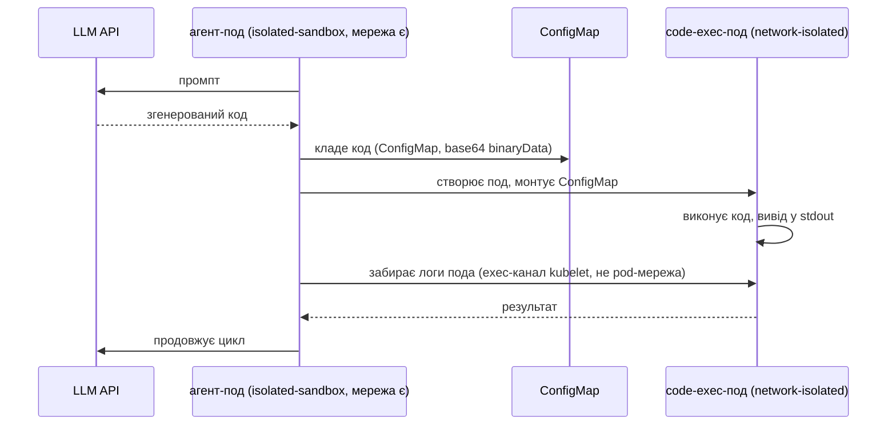

# ARTICLE-UK.md (чернетка, українська версія ARTICLE.md)

<!--
Статус: DRAFT 1, для CB Speed Run 2 (сабміт 16–23 листопада).
Всі числа в [ДУЖКАХ] мають бути заповнені з реального прогону бенчмарку.
Все з поміткою (перевірити) — звірити з доками до сабміту.
Сабмітити з плейсхолдерами не можна.
-->

# AI-агенти в апаратній ізоляції на EKS з Nitro Sandboxes: практичний гайд, з порівнянням із gVisor

Твоєму AI-агенту треба запускати написаний ним код. Цей код вийшов з моделі, яка читає інтернет, і довіряти йому не можна. Тому середовище виконання мусить мати справжню межу ізоляції. 9 листопада 2026 AWS випустила такий новий інструмент: [Nitro Sandboxes](TODO-лінк-на-анонс) — легкі VM під управлінням Nitro Hypervisor, доступні для подів EKS, тасків ECS і окремих VM на EC2, без додаткової плати.

У цьому гайді — як запровадити агенти на них на практиці: підняти кластер, де Nitro Sandboxes, gVisor і звичайний runc працюють поруч на однакових інстансах, зібрати патерн «агент виконує код в ізольованому поді» від початку до кінця і поміряти, скільки ізоляція коштує в часі старту і щільності.

## Три рівні ізоляції на тому самому інстансі

Візьми один `m8i.xlarge` трьома способами, і різниця видна навіть в `uname -r` всередині пода:

| Рантайм | Межа | Ядро, яке бачить под |
|---|---|---|
| runc (дефолт) | namespaces, cgroups | хост-ядро (AL2023) |
| [gVisor](https://gvisor.dev) через `runsc` | перехоплення системних викликів у юзерспейсі | синтетичне ядро, Sentry |
| Nitro Sandbox | апаратна VM під Nitro Hypervisor | власне гостьове ядро |

Середній варіант виглядає як трюк у софтвері, бо ним і є: gVisor перереалізовує Linux-ядро в процесі юзерспейсу. Працює несподівано добре і запускається на будь-якому типі інстансів.

Nitro Sandbox працює інакше. Кожен под стає мікро-VM так само, як функція Lambda: контейнер пода живе всередині VM з власним ядром, запущеної на тому ж EC2-інстансі, який ти вже орендуєш. З цього виходять два наслідки:

1. Секрети можна віддавати тільки пісочницям, які довели свою цілісність криптографічною атестацією: виміри пісочниці живуть у PCR-регістрах, а key policy в KMS з умовами `kms:RecipientAttestation:PCR` віддає ключі розшифрування тільки при збігу. Застереження прямо з доків: без такої key policy (або іншого зовнішнього верафікатора) вимір записується, але ніколи не перевіряється. Це критично для регульованих навантажень і для випадків, коли агент тримає креденшели.
2. Межа ізоляції апаратна, та сама, яку AWS ставить між твоїми інстансами і між Lambda-навантаженням та хостом.

Старий шлях до «справжньої VM всередині пода» — Kata Containers на nested virtualization. Він працює досі, але тепер зі зірочкою: nested virtualization обмежена Intel 8-го покоління (c8i/m8i/r8i), на Graviton її немає, і атестації теж немає. Nitro Sandboxes знімають усі три обмеження (підтримку Graviton — звірити з анонсом до сабміту).

## Розгортання кластера

EKS Auto Mode з Kubernetes 1.36 чи новішим — найкоротший шлях, а вмикання Nitro Sandboxes для пода — зміна одного рядка:

```yaml
spec:
  runtimeClassName: isolated-sandbox
```

Решта пода лишається нативною: Pod Identity, VPC CNI, EBS/EFS/S3, CloudWatch працюють як звично.

Кластер з цього гайду ([весь Terraform тут](TODO-лінк-на-репо)) — один Auto Mode кластер з NodePool, прибитим до `m8i.xlarge`, плюс gVisor на managed node group того ж типу інстансу:

```yaml
# Auto Mode NodePool для Nitro Sandbox-подів
apiVersion: karpenter.sh/v1
kind: NodePool
metadata:
  name: sandbox-nitro
spec:
  template:
    metadata:
      labels: { sandbox-runtime: nitro }
    spec:
      taints:
        - { key: sandbox, value: nitro, effect: NoSchedule }
      requirements:
        - key: eks.amazonaws.com/instance-family
          operator: In
          values: ["m8i"]
```

```yaml
# Один із чотирьох smoke-тестових подів
apiVersion: v1
kind: Pod
metadata:
  name: nitro-codeexec
  annotations:
    sandbox.amazonaws.com/network-isolated: "true"   # мережевого пристрою немає взагалі
spec:
  runtimeClassName: isolated-sandbox
  nodeSelector: { sandbox-runtime: nitro }
  tolerations:
    - { key: sandbox, operator: Equal, value: nitro, effect: NoSchedule }
```

Дві речі, які корисно знати до дебагу:

- Поди без toleration taint'а і nodeSelector їдуть на стандартний рантайм. Ізоляція — opt-in, на рівні пода, а не кластера.
- Анотація `network-isolated` забирає в пода мережевий пристрій цілком: без DNS, без IMDS, без креденшелів Pod Identity. Побічний ефект, на якому ти обов'язково поїдеш: HTTP- і TCP-проби перестають працювати, тож такі поди беруть лише exec-проби. `kubectl port-forward` до такого пода взагалі не достукається; логи, exec і статистика продовжують працювати через vsock-канал, який не залежить від pod-мережі.

Повне розгортання на дефолтному VPC зайняло [ЧИСЛО] хвилин у `terraform apply` (31 ресурс: приватні сабнети, NAT gateway, кластер, аддони, дві нодгрупи). Цікаве живе в трьох файлах: NodePool вище, `RuntimeClass` для gVisor і NodeConfig, який вчить containerd про `runsc` і ставить gVisor при буті ноди.

Після розгортання чотири probe-поди підтвердили таблицю: runc надрукував хост-ядро, Nitro Sandbox-под — гостьове, network-isolated-под бачив тільки `lo` і не дістався інтернету, gVisor-под — ядро Sentry. [РЕЗУЛЬТАТИ, ЧИСЛА]

## Патерн: агент з мережею, код — без неї

Схема, яку всі насправді хочуть, має дві ролі:



Агент-под зберігає мережу: він говорить з API моделі і з Kubernetes API. Згенерований код їде в окремому поді без мережевого пристрою, без Pod Identity і без SA-токена. Вони не мають спільного сокета — тільки API-об'єкти.

Три замітки з реалізації, на які я витратив більше за все часу:

**emptyDir не працює для цього, двома різними способами.** Він pod-скиповний, тож дві пода не можуть ним поділитися; а два контейнери в одній поді теж не рятують, бо анотація `network-isolated` — pod-рівнева: агент втратив би і свою мережу. Тому обмін іде через API-сервер.

**Код передається як base64 у `binaryData`.** Kubernetes монтує `binaryData` як декодовані байти, а в shell це нуль екранування JSON. У скрипті агента немає ані kubectl, ані jq усередині sandbox VM; сирі REST-виклики curl'ом через SA-токен і CA, які kubelet монтує сам, працюють нормально. Список залежностей — alpine і `apk add curl`.

**code-exec-под не монтує SA взагалі.** Постав `automountServiceAccountToken: false`. Згенерований код не має права дзвонити в Kubernetes API, створювати поди, читати секрети, навіть без мережі. RBAC навколо агента — у межах його namespace: створювати і видаляти поди та ConfigMaps у своєму namespace, читати логи подів, нічого більше.

Повний цикл агента — один скрипт у ConfigMap і один pod spec; маніфест [тут](TODO-лінк-на-репо). У дефолтній демонстрації згенерований код сам звітує про свою ізоляцію і друкує `NETWORK: blocked`, `SA token: absent`. [РЕЗУЛЬТАТИ E2E, ЧИСЛА]

## Скільки коштує ізоляція

Метод: для cold start — N подів кожного рантайму, час від `kubectl apply` до Ready, по поду від `creationTimestamp` до Ready-кондишини, плюс wall time; прогін двічі, перший включає бутстрап ноди. Для щільності — продовжуємо аплаїти 1-vCPU `sleep`-подів, поки Ready не перестає рости.

| Метрика | runc | Nitro Sandbox | gVisor |
|---|---|---|---|
| Cold start, p50 / p90 (тепла нода) | [ЧИСЛО] | [ЧИСЛО] | [ЧИСЛО] |
| Щільність: 1-vCPU подів на m8i.xlarge | [ЧИСЛО] | [ЧИСЛО] | [ЧИСЛО] |
| Вартість pod-години при такій щільності | [ЧИСЛО] | [ЧИСЛО] | [ЧИСЛО] |

Два очікування, які варто перевірити на своєму прогоні:

- Щільність. Доки тут все явне з доків, і числа виходять вищі за очікування. На ноду діють два обмеження, обидва = 5× кількість vCPU ноди: сумарні vCPU, розподілені між усіма sandbox'ами, і кількість самих sandbox'ів (ліміт кількості вдвічі менший на CPU-overcommit типах). На 4-vCPU `m8i.xlarge` це до 20 sandbox'ів по 1 vCPU. Кожен sandbox-под ще несе фіксований memory overhead, який планувальник додає зверх запиту пода: 256 MiB для `isolated-sandbox`, 512 MiB для `confidential-sandbox`. І на SMT-інстансах (всі Intel, більшість AMD) core scheduling не пускає два різні sandbox'и на сусідні потоки одного ядра, тож обчислень, доступних sandbox-подам, приблизно половина від задекларованих vCPU; Graviton (потік на ядро) не зачеплений. Остання дрібниця міняє математику щільності на `m8i` — і її варто поміряти напряму. У gVisor таких обмежень немає, тож точка перетину — де щільність перемагає час старту.
- Вартість. Auto Mode бере плату менеджменту поверх EC2, якої немає в managed node groups. Для чесного pod-години її рахувати окремим рядком. NAT для приватних сабнетів ≈ $0.045/год, і він тікає навіть без трафіку, тож демо знищуй одразу після прогону.

## Де це не підходить

- **GPU passthrough поки немає.** Локальний inference всередині Nitro Sandbox сьогодні неможливий. Агенту з локальною моделлю — або API, або gVisor, який успадковує GPU хоста через runc-сумісні пристрої.
- **Ні resize, ні snapshot.** CPU і пам'ять виділяються при старті пода: in-place resize не підтримується, зміна = видалити і перестворити под з новими запитами. У примітива також немає snapshot/restore і live migration, тож idle-агенти продовжують платити за свої ресурси.
- **Привілеї самого агента — справжній ризик.** Згенерований код у цьому патерні добре огороджений (без мережі, без токена, без API). Але агент-под тримає create-pods у своєму namespace, і admission сьогодні не гейтає його pod-спеки. Для прода це Pod Security Standards на namespace і admission-гейт на `runtimeClassName` і hostPath, або винесення створення подів із пода, обличчям до моделі. Це має бути прямо в тексті статті, і демо саме собою це не закриває.
- **Публічний endpoint кластера.** В цьому гайді `endpoint_public_access` лишається увімкненим без CIDR-allowlist заради короткого демо. У будь-якому, що живе довше, — обмежити (`endpoint_public_access_cidrs`) або вимкнути, приватний доступ уже ввімкнений.
- **vsock-канал — відома поверхня.** Докі самі про це кажуть: vsock-пристрій, яким ходить спілкування shim↔agent, доступний процесам всередині guest'а, а будь-який процес на parent-інстансі з доступом до Firecracker vsock-сокета може конектитись до guest-портів, включно з network-isolated подами. Це не класичний network bypass, але рядок «немає мережевого пристрою» в security-рев'ю заслуговує на цю зірочку.

## Висновки

Для агентів, що виконують модельний код на EKS сьогодні:

1. Nitro Sandboxes — найдешевший шлях до апаратної межі ізоляції на под, і єдиний з атестацією. Вмикання — один рядок, под лишається нативним.
2. gVisor досі виграє там, де щільність важить більше за міцність межі, і де мають значення GPU.
3. Nested virtualization для Kata — тепер legacy-шлях. Якщо вже працює — ок; для нового — Nitro Sandboxes заміщують його на тому ж класі інстансів, який ти й так, можливо, запускаєш.

Патерн вище (агент з мережею, код без неї) достатньо малий, щоб тягнувся однією людиною, і достатньо строгий, щоб пережити security-рев'ю — після того, як закриті дві прогалини в admission з попереднього розділу.

Весь Terraform, маніфести, налаштування пода агента і скрипт бенчмарку лежать у [TODO: публічне посилання на репо до сабміту]; числа в таблицях заповнюються з прогонів, записаних у `benchmark-results.csv`.

## Джерела

- [Sandboxing on Amazon EKS](https://docs.aws.amazon.com/eks/latest/userguide/sandboxing.html) — key features, атестація, encrypted images
- [Nitro Sandboxes considerations, EKS](https://docs.aws.amazon.com/eks/latest/userguide/sandboxing-limitations.html) — ліміти щільності, SMT core scheduling, resize й пристрої
- [Network isolation](https://docs.aws.amazon.com/eks/latest/userguide/sandboxing-network-isolation.html) — exec-проби, поведінка vsock-каналу
- [Autoscaling with Nitro Sandboxes](https://docs.aws.amazon.com/eks/latest/userguide/autoscaling.html) — slot overhead (256/512 MiB), провіженінг
- [Setup paths on EKS](https://docs.aws.amazon.com/eks/latest/userguide/sandboxing-isolated-setup.html) — Auto Mode проти node groups, K8s >= 1.36
- [Amazon EC2 Nitro Sandboxes](https://docs.aws.amazon.com/AWSEC2/latest/UserGuide/amazon-ec2-nitro-sandboxes.html) — підтримка інстансів (Intel/AMD/Graviton), вибір примітива
- [gVisor documentation](https://gvisor.dev/docs/)

<!--
TODO до сабміту (з PLAN.md, день експериментів):
[ ] прогнати smoke-тести, заповнити докази по ядрах
[ ] перевірити гіпотезу кастомного NodePool (або прибрати абзац)
[ ] прогнати coldstart двічі на рантайм, заповнити p50/p90
[ ] прогнати density, заповнити таблицю і звірити з задокументованими лімітами (5× vCPU-алокація + 5× кількість, вдвічі менше на CPU-overcommit; 256 MiB overhead на под; SMT core-scheduling ефект на m8i)
[ ] прогнати E2E демо агента, заповнити результати
- звірено з офіційними доками 10 листопада 2026: Graviton, застереження KMS PCR при атестації, немає GPU passthrough, немає resize/snapshot/live-migration, K8s >= 1.36, без додаткової плати, exec/логи через vsock
[ ] зафіксувати gVisor-реліз у gvisor.mime і навести версії
[ ] звірити цифру Auto Mode fee з білінгом/прайсингом
[ ] закрити або явно позначити дві сек'юриті-діри перед публікацією маніфестів
-->
