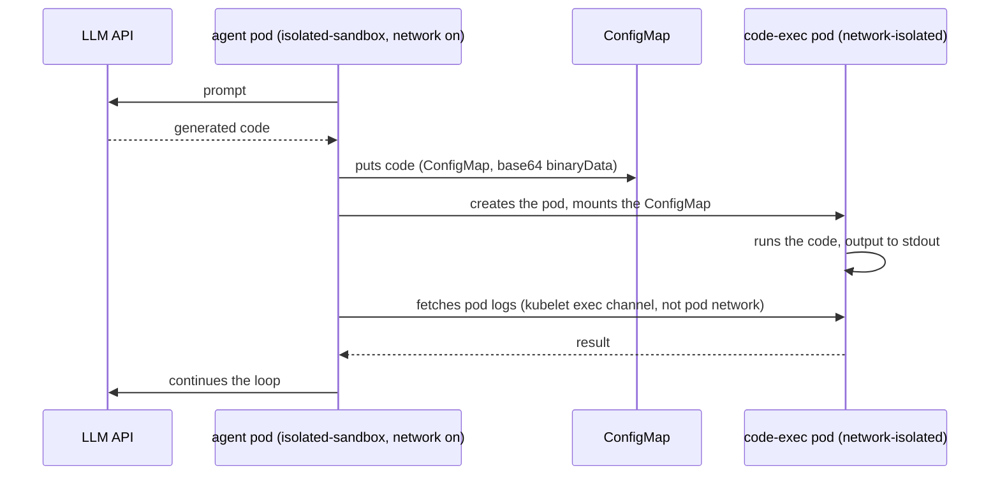

# ARTICLE.md (draft)

<!--
Status: DRAFT 1, for CB Speed Run 2 (submit window Nov 16-23).
Language: English (publication target - AWS Builder Center).
Honesty rules for this draft:
- Every number in [BRACKETS] must come from a real benchmark run before submit.
- Every claim marked (verify) must be confirmed on the cluster before submit.
- Do not submit with placeholders left in.
-->

# Hardware-isolated AI agents on EKS with Nitro Sandboxes: a hands-on guide, with a gVisor comparison

Your AI agent writes code and needs to run it. The code came out of a model that reads the internet, and you cannot trust it. So the execution environment needs a real isolation boundary. On November 9, 2026, AWS shipped a new one: [Nitro Sandboxes](https://aws.amazon.com/blogs/aws/TODO-announcement-link), lightweight VMs managed by the Nitro Hypervisor, now available for EKS pods, ECS tasks and standalone EC2 VMs at no extra charge.

This guide shows how to actually implement agents on them: bring up a cluster where Nitro Sandboxes, gVisor and plain runc run side by side on identical instances, wire the "agent runs code in an isolated pod" pattern end to end, and measure what the isolation costs in start time and density.

## Three isolation levels, on the same instance

Run one `m8i.xlarge` three ways and the difference is visible with `uname -r` on a pod:

| Runtime | Boundary | Kernel the pod runs |
|---|---|---|
| runc (the default) | namespaces, cgroups | the host kernel (AL2023) |
| [gVisor](https://gvisor.dev) via `runsc` | user-space syscall interception | a synthetic kernel, the Sentry |
| Nitro Sandbox | a hardware VM under the Nitro Hypervisor | its own guest kernel |

The middle option looks like a software trick because it is one: gVisor reimplements a Linux kernel in a user-space process. It works surprisingly well, and it runs on any instance type.

The Nitro Sandbox route is different. Each pod becomes a micro-VM the way a Lambda function is one: the pod container runs inside a VM with its own kernel, started on the same EC2 instance you already rent. Two things follow from this:

1. Secrets can be released only to sandboxes that prove their integrity with cryptographic attestation. That matters for regulated workloads and for anything where an agent holds credentials.
2. The isolation boundary is hardware, the same one AWS uses between your instances and between a Lambda workload and its host.

The old approach for "a real VM inside a pod" was Kata Containers on nested virtualization. It still works, but it now has an asterisk: nested virtualization is limited to 8th-gen Intel instances (c8i/m8i/r8i), it is not available on Graviton, and there is no attestation. Nitro Sandboxes lift all three (Graviton support: verify against the announcement before submit).

## Bringing up the cluster

EKS Auto Mode with Kubernetes 1.36 or newer is the shortest path, and enabling Nitro Sandboxes for pods is a one-line change:

```yaml
spec:
  runtimeClassName: isolated-sandbox
```

Everything else in the pod stays native: Pod Identity, VPC CNI, EBS/EFS/S3 volumes, CloudWatch all work as usual.

The cluster in this guide ([full Terraform here](TODO-repo-link-or-private-repo-note)) is one Auto Mode cluster with a NodePool pinned to `m8i.xlarge`, plus gVisor on a managed node group using the same instance type:

```yaml
# Auto Mode NodePool for Nitro Sandbox pods
apiVersion: karpenter.sh/v1
kind: NodePool
metadata:
  name: sandbox-nitro
spec:
  template:
    metadata:
      labels: { sandbox-runtime: nitro }
    spec:
      taints:
        - { key: sandbox, value: nitro, effect: NoSchedule }
      requirements:
        - key: eks.amazonaws.com/instance-family
          operator: In
          values: ["m8i"]
```

```yaml
# One of the four smoke-test pods
apiVersion: v1
kind: Pod
metadata:
  name: nitro-codeexec
  annotations:
    sandbox.amazonaws.com/network-isolated: "true"   # no network device at all
spec:
  runtimeClassName: isolated-sandbox
  nodeSelector: { sandbox-runtime: nitro }
  tolerations:
    - { key: sandbox, operator: Equal, value: nitro, effect: NoSchedule }
```

Two details worth knowing before you debug:

- Pods without the taint toleration and nodeSelector land on the standard runtime. The isolation is opt-in, per pod, not per cluster.
- The `network-isolated` annotation removes the pod's network device entirely: no DNS, no IMDS, no Pod Identity credentials. That has a side effect you will hit immediately: HTTP and TCP probes stop working, so such pods take exec probes only.

The full bring-up on a default VPC took [NUMBER] minutes with `terraform apply` (31 resources: private subnets, a NAT gateway, the cluster, admin add-ons, two node groups). The interesting parts live in three files: the NodePool above, a `RuntimeClass` for gVisor, and a NodeConfig that teaches containerd about `runsc` and installs gVisor on node boot.

After the cluster came up, four probe pods confirmed the diagram from the table: runc printed the host kernel, the Nitro Sandbox pod printed a guest kernel, the network-isolated pod saw only `lo` and could not reach the internet, and the gVisor pod printed the Sentry kernel. [RESULTS, NUMBERS]

## The pattern: agent with network, code without it

The setup everyone actually wants is two roles:



The agent pod keeps its network: it talks to the model API and to the Kubernetes API. The generated code runs in a separate pod with no network device, no Pod Identity and no service account token. The two never share a socket, only API objects.

Three implementation notes that cost me the most time to figure out:

**emptyDir does not work for this, in two different ways.** It is pod-scoped, so two pods cannot share one. And putting both containers into one pod does not help either, because the `network-isolated` annotation is pod-level: the agent would lose its network too. This is why the exchange goes through the API server.

**The code travels as base64 in `binaryData`.** Kubernetes mounts a `binaryData` entry as the decoded bytes, and in shell it means zero JSON escaping. The agent script has no kubectl and no jq inside the sandbox VM; raw REST calls via curl over the service-account token and CA that kubelet already mounts work fine. alpine plus `apk add curl` is the whole dependency list.

**The code-exec pod mounts no service account at all.** Set `automountServiceAccountToken: false` on it. Generated code should not be able to call the Kubernetes API, create pods, or read secrets, even though it already has no network. The RBAC around the agent is namespace-scoped: create and delete pods and ConfigMaps in its own namespace, get pod logs, nothing else.

The full agent loop is one ConfigMap script and one pod spec; the manifest is [here](TODO-repo-link). On the default demo, the generated code self-checks its own isolation and prints `NETWORK: blocked`, `SA token: absent`. [E2E RUN RESULTS, NUMBERS]

## What isolation costs

Method: for cold start, N pods of each runtime, time from `kubectl apply` to Ready, measured per pod from `creationTimestamp` to the Ready condition, plus wall time; run twice, the first run includes node bootstrap. For density, keep applying 1-vCPU `sleep` pods until Ready stops growing.

| Metric | runc | Nitro Sandbox | gVisor |
|---|---|---|---|
| Cold start, p50 / p90 (warm node) | [NUMBER] | [NUMBER] | [NUMBER] |
| Density: 1-vCPU pods per m8i.xlarge | [NUMBER] | [NUMBER] | [NUMBER] |
| Cost per pod-hour at that density | [NUMBER] | [NUMBER] | [NUMBER] |

Two expectations to check against your own run:

- Density. A sandbox VM wants host resources beyond the container limits, and the working suspicion is a 5x vCPU factor for Nitro Sandboxes. On a 4-vCPU `m8i.xlarge` that would cap around [NUMBER] sandbox pods per node. gVisor has no such factor, so the crossover is where density beats start time.
- Cost. Auto Mode charges a management fee on top of EC2 that managed node groups do not have. For an honest per-pod-hour comparison, include it as a separate row. NAT for the private subnets is about $0.045 per hour, and it bills whether or not your cluster has traffic, so tear the demo down after the run.

## Where it does not fit

- **No GPU passthrough yet.** Local inference inside a Nitro Sandbox is not possible today. If your agents need a local model, the sandbox runs it over the network or you stay on gVisor, which inherits host GPUs through runc-compatible devices.
- **No resize, no suspend.** A sandbox is created at a fixed size; changing it means recreating the pod. Idle agents keep paying for their resources. Snapshot and restore would make idle agents cheap; today that is future work.
- **The agent's own privileges are the real risk.** Generated code is well fenced in this pattern (no network, no token, no API). The agent pod itself holds a create-pods permission in its namespace, and admission today does not gate its pod specs. For production, this needs a Pod Security Standards policy on the namespace and an admission gate on `runtimeClassName` and hostPath, or moving pod creation out of the model-facing pod entirely. The write-up of this pattern should state this plainly; the demo cannot.
- **Public cluster endpoint.** This guide's cluster keeps `endpoint_public_access` on without a CIDR allowlist for the sake of a short demo. In anything long-lived, restrict it (`endpoint_public_access_cidrs`) or drop it, private access is already on.

## Takeaways

For agents that execute model-written code on EKS today:

1. Nitro Sandboxes are the cheapest way to get a hardware isolation boundary per pod, and the only one with attestation. Enablement is one line, and the pod stays native.
2. gVisor still wins where density matters more than the boundary strength, and where GPUs matter.
3. Nested virtualization for Kata is the legacy path now. If you have it running, fine; for new work, Nitro Sandboxes replace it on the same instance class you likely already run.

The pattern above (agent with network, code without) is small enough to be owned by one person and strict enough to survive a security review, with the two admission gaps from the last section closed first.

All Terraform, manifests, the agent pod setup and the benchmark script are in [TODO: public repo link by submit time]; numbers in the tables get filled in from the benchmark runs recorded in `benchmark-results.csv`.

<!--
PRE-SUBMIT TODO (from PLAN.md, experiment day):
[ ] run smoke tests, fill in kernel evidence
[ ] verify custom NodePool scheduling hypothesis (or drop that paragraph)
[ ] run coldstart twice per runtime, fill p50/p90
[ ] run density, fill the table and the 5x verdict
[ ] run E2E agent demo, fill results
[ ] confirm Graviton + attestation claims from official docs
[ ] pin gVisor release in gvisor.mime and cite versions
[ ] confirm Auto Mode fee figure from billing/pricing docs
[ ] close or clearly flag the two security gaps before publishing manifests publicly
-->
