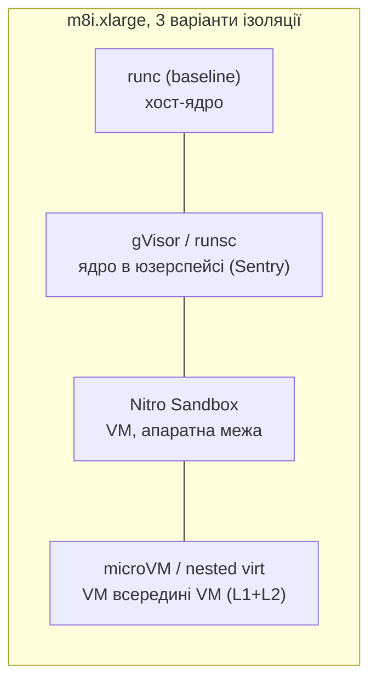
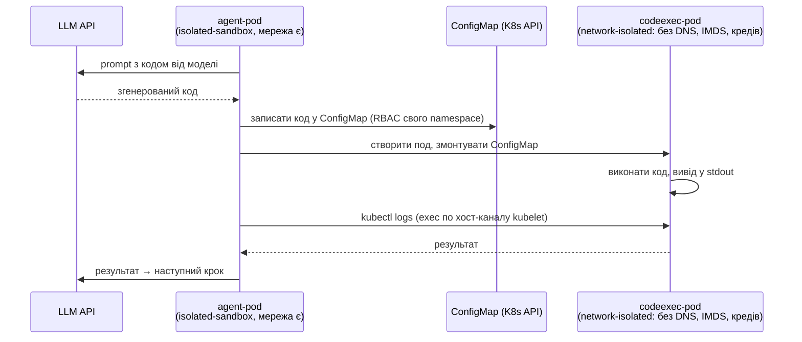

# План: Hardware-isolated AI agents on EKS with Nitro Sandboxes (vs gVisor)

Стаття для CB Speed Run 2. Тут — як працює стенд, патерн агента, список експериментів і застереження.
Код — у цьому ж каталозі (`eks-sandboxes/`).

## Стенд

Один `terraform apply` піднімає кластер Kubernetes 1.36 (EKS Auto Mode) і три пули нод
на одному типу інстансу `m8i.xlarge` — для порівнянності.

| Пул | Механізм | Код у репо |
|-----|----------|-----------|
| nitro (Auto Mode NodePool) | под ⇒ VM від Nitro Hypervisor, своє гостьове ядро | `00-nodepool-nitro.yaml` |
| gvisor (MNG) | ядро в юзерспейсі через runsc у containerd | `gvisor-nodegroup.tf`, `gvisor.mime`, `01-runtimeclass-gvisor.yaml` |
| microvm (MNG, nested virt) | VM всередині VM: Firecracker/Kata на L2 | `microvm-nodegroup.tf` |

Isolation-сходи від "просто runc" до "апаратна VM": runc бачить хост-ядро → gVisor —
фейкове ядро в юзерспейсі → Nitro Sandbox — справжнє ядро в апаратній межі.

Плюси Nitro: криптографічна атестація, Graviton-шлях у майбутньому, вмикання одним рядком
(`runtimeClassName: isolated-sandbox`). Мінус (гіпотеза): ~5× витрата vCPU на пісочницю — мірятимемо.

## Патерн агента

Дві поди: агент у `isolated-sandbox` з мережею, згенерований код — у другій поді з
`sandbox.amazonaws.com/network-isolated: "true"`.

Чому обмін — через API-сервер, а не emptyDir:

- **emptyDir не працює.** Він pod-скиповний: дві окремі поди ним не діляться.
- **Обидва контейнери в одній поді теж не працюють.** Анотація `network-isolated` —
  pod-рівнева, мережа зникла б у всієї поди, разом з агентом і доступом до LLM API.
- API-варіант чесний для статті: тільки перевірювані примітиви (RBAC, ConfigMap,
  exec-логи kubelet). kubelet спілкується з пісочницею по хост-каналу, а не по pod-мережі,
  тому exec живе без мережевого пристрою всередині VM.

Не підтверджено (перевірити на практиці):
- чи монтується ConfigMap всередині sandbox VM;
- чи анотація відрізає тільки pod-мережу, а exec лишається живим.

Патерн «дві поди + emptyDir» — тупик. Прибрати з майбутнього тексту.

## Експерименти

| # | Що міряємо | Файл | Успіх |
|---|-----------|------|-------|
| 1 | Smoke-тест ізоляції: `uname -r`, інтерфейси, wget | `10-smoke-tests.yaml` | runc → хост-ядро; nitro → гостьове; nitro-codeexec → тільки `lo`, wget блокується; gvisor → ядро Sentry |
| 2 | Гіпотеза кастомного NodePool Auto Mode | `00-nodepool-nitro.yaml` | поди з `isolated-sandbox` плануються на пул, прибитий до `m8i.xlarge`. Якщо Pending — прибрати nodeSelector, перейти на general-purpose |
| 3 | Cold start: N подів, apply → Ready, warm + cold | `20-benchmark.sh coldstart` | CSV з per-pod часом для runc / nitro / gvisor (+ microvm) |
| 4 | Щільність: 1-vCPU поди до плато | `20-benchmark.sh density` | Гіпотеза: nitro m8i.xlarge (4 vCPU) → плато ~20; gvisor/runc — вище. Звідси вартість одного агента |
| 5 | E2E патерн агента | `30-agent-codeexec.yaml` | Код виконується, wget блокується, SA-токена нема (automount=false), результат повертається агенту через exec-логи; RBAC тільки у своєму namespace |

Експеримент 1 — передумова для всіх інших.

## Вартість (окремий рядок статті)

Auto Mode стягує окрему плату поверх EC2; MNG-пули (gvisor, microvm) її не мають.
Без цього рядка порівняння нечесне. Рахувати: $/год ноди + $/год за слот агента з урахуванням щільності.
Додатково від демо на приватних сабнетах: NAT gateway (+ EIP) ≈ $0.045/год = ~$32 міс, якщо забути destroy.

## Чекліст відтворюваності перед прогоном

- [ ] aws-провайдер >= 6.0 зафіксований точною версією (Auto Mode + nested virt)
- [ ] на gvisor-ноді через SSM: `containerd --version` → права секція у `gvisor.mime` (1.7 або 2.x)
- [ ] `GVISOR_RELEASE` замість `latest` у `gvisor.mime`
- [ ] gVisor-реліз записати в текст статті разом з версіями Kubernetes і aws-провайдера

## Порядок роботи

1. Smoke-тест + гіпотеза NodePool (експерименти 1-2)
2. Маніфести агента з ConfigMap-обміном
3. Бенчмарки: cold start, щільність (експерименти 3-4)
4. E2E агента (експеримент 5)
5. Розділ вартості
