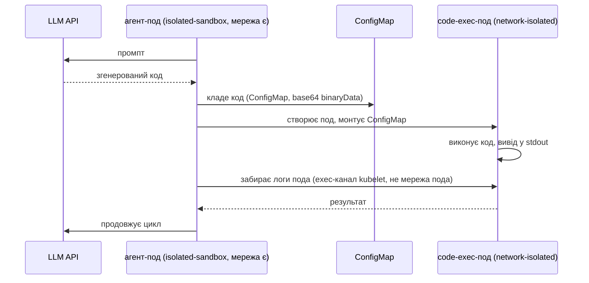

# ARTICLE-UK.md (чернетка, українська версія ARTICLE.md)

<!--
Статус: DRAFT 4 (13 листопада 2026), для CB Speed Run 2 (сабміт 16–23 листопада).
Синхронізовано з ARTICLE.md після фідбеку читача.
Числа в тексті з реальних прогонів, докази в data/ (evidence/, benchmark-results.csv, bench-pass1-raw.csv).
-->

# Запуск коду від AI-агента на EKS у Nitro Sandboxes: практичний гайд

*Автор: [Igor Gorovyy](https://www.linkedin.com/in/gorovyyigor/), DevOps Engineer Lead & Senior Solutions Architect, AWS Community Builder*

Ти даєш AI-агенту писати код і виконувати його. Цей код вийшов з моделі, яка читає інтернет, тож довіряти йому не можна, а звичайний контейнер для недовіреного коду слабка огорожа. 9 листопада 2026 AWS випустила міцнішу: [Nitro Sandboxes](https://aws.amazon.com/about-aws/whats-new/2026/11/nitro-sandboxes-eks-ecs-ec2/). Кожен под працює у власній маленькій VM під тим самим Nitro Hypervisor, який відділяє EC2-інстанси один від одного. Це працює для подів EKS, тасків ECS і окремих EC2, без додаткової плати.

Гайд про три речі, в такому порядку:

1. Що Nitro Sandbox змінює порівняно зі звичайним контейнером.
2. Як увімкнути його для пода і як запускати код агента в поді без мережі.
3. Скільки це коштує в часі старту і подах на ноду, на заміряних на живому кластері числах.

## Чому звичайного контейнера мало

Звичайний под у Kubernetes працює на runc, дефолтному рантаймі контейнерів. runc ізолює контейнер через namespaces і cgroups Linux, але всі контейнери на ноді ділять одне ядро з хостом. Якщо код всередині знайде баг у ядрі, він може вийти з контейнера на ноду, а звідти до інших подів на ній. Для коду, який ти написав сам, цей ризик зазвичай прийнятний. Для коду, який щойно згенерувала модель, ні.

Є два поширені способи поставити щось міцніше між кодом і ядром хоста:

| Рантайм | Як ізолює | З яким ядром говорить код |
|---|---|---|
| runc (дефолт) | namespaces і cgroups | ядро хоста, спільне для всіх подів на ноді |
| [gVisor](https://gvisor.dev) (`runsc`) | перехоплює системні виклики в процесі юзерспейсу | власна реалізація Linux-ядра від gVisor, Sentry |
| Nitro Sandbox | апаратна VM під Nitro Hypervisor | власне гостьове ядро всередині VM |

Різницю видно через `uname -r` всередині пода. На тій самій ноді `m8i.xlarge` мій runc-под надрукував ядро хоста `6.18.56`, Nitro Sandbox-под своє гостьове ядро `6.18.54`, а gVisor-под `4.19.0-gvisor`, тобто Sentry.

З Nitro Sandbox вихід з контейнера опиняється всередині VM, а не на ноді. Щоб дістатися ноди, треба ще зламати гіпервізор, тобто ту саму межу, на яку AWS покладається між інстансами різних клієнтів.

Ще Nitro Sandboxes підтримують атестацію, і її можна використати для секретів. Кожна пісочниця записує виміри того, що в ній завантажилось (у PCR-регістри). Key policy в KMS з умовами `kms:RecipientAttestation:PCR` може віддавати ключ розшифрування тільки пісочниці, чиї виміри збігаються. Але є нюанс, прямо з доків: без такої key policy (або іншого зовнішнього верифікатора) виміри записуються, і їх ніхто не перевіряє. Якщо агент працює з креденшелами, налаштуй цю політику.

До Nitro Sandboxes звичайний шлях до VM на кожен под був Kata Containers на nested virtualization. Він працює досі, але має три обмеження: nested virtualization є тільки на Intel 8-го покоління (c8i/m8i/r8i), на Graviton її немає, і атестації немає. У Nitro Sandboxes жодного з цих обмежень немає.

## Як увімкнути для пода

Потрібен EKS Auto Mode з Kubernetes 1.36 чи новішим. Тоді под вмикає пісочницю одним рядком:

```yaml
spec:
  runtimeClassName: isolated-sandbox
```

Решта пода працює як звично: Pod Identity, VPC CNI, томи EBS/EFS/S3, CloudWatch.

Щоб порівняти рантайми, я зібрав один кластер на Terraform ([весь код у репо](https://github.com/igorgorovoy/eks-sandboxes)): Auto Mode кластер з NodePool, прибитим до `m8i.xlarge`, для sandbox-подів, плюс managed node group того ж типу інстансу з gVisor. Однакове залізо для всіх трьох рантаймів, тож числа нижче можна порівнювати.

```yaml
# Auto Mode NodePool для Nitro Sandbox-подів
apiVersion: karpenter.sh/v1
kind: NodePool
metadata:
  name: sandbox-nitro
spec:
  template:
    metadata:
      labels: { sandbox-runtime: nitro }
    spec:
      taints:
        - { key: sandbox, value: nitro, effect: NoSchedule }
      requirements:
        - key: eks.amazonaws.com/instance-family
          operator: In
          values: ["m8i"]
```

Под, який виконує згенерований код, виглядає так:

```yaml
apiVersion: v1
kind: Pod
metadata:
  name: nitro-codeexec
  annotations:
    sandbox.amazonaws.com/network-isolated: "true"   # мережевого пристрою немає взагалі
spec:
  runtimeClassName: isolated-sandbox
  nodeSelector: { sandbox-runtime: nitro }
  tolerations:
    - { key: sandbox, operator: Equal, value: nitro, effect: NoSchedule }
```

Дві речі, на які ти натрапиш:

- Ізоляція вмикається на рівні пода, а не кластера. Под без `runtimeClassName`, toleration і nodeSelector працює на звичайному runc.
- Анотація `network-isolated` повністю забирає в пода мережевий пристрій: без DNS, без метаданих інстансу (IMDS), без креденшелів Pod Identity. Тому HTTP- і TCP-проби перестають працювати, і такі поди можуть використовувати тільки exec-проби. `kubectl port-forward` до них теж не дістається. Логи, exec і статистика працюють, бо йдуть окремим vsock-каналом між нодою і VM, а не через мережу пода.

З `terraform apply` на дефолтному VPC усе розгортання зайняло близько 20 хвилин: 31 ресурс, серед них приватні сабнети, NAT gateway, кластер, аддони і дві нодгрупи. Крім NodePool вище, потрібні `RuntimeClass` для gVisor і NodeConfig, який ставить gVisor при старті ноди.

Щоб перевірити розгортання, я запустив чотири тестові поди. Результати збіглися з таблицею: runc надрукував ядро ноди, Nitro Sandbox-под своє ядро і рівно 1 vCPU, який запросив, gVisor-под ядро Sentry, а network-isolated под бачив тільки інтерфейс `lo` і не зміг зробити DNS-запит (`wget: bad address`). Повні виводи в репо, `data/evidence/runtime-evidence.txt`.

## Запуск згенерованого коду: агент з мережею, код без неї

Агенту потрібна мережа, щоб звертатися до API моделі. Коду, який генерує модель, мережа не потрібна, і її не має бути: без мережі він не може нікуди відправити твої дані чи щось завантажити. Тому я розніс їх у два окремі поди:

- **Агент-под** працює в Nitro Sandbox з мережею. Він говорить з LLM API і з Kubernetes API.
- **Code-exec-под** працює в Nitro Sandbox без мережевого пристрою, без Pod Identity і без токена service account. Він тільки виконує код і друкує результат.

Ці два поди ніколи не спілкуються через мережу. Агент передає код через ConfigMap і читає результат з логів пода:



Найбільше часу в реалізації забрали три деталі:

**Спільний emptyDir тут не працює.** emptyDir належить одному поду, тож два поди не можуть ним поділитися. Поставити агента і код двома контейнерами в один под теж не виходить: анотація `network-isolated` діє на весь под, і агент втратив би мережу. Тому код іде через API-сервер у ConfigMap.

**Код кладеться в `binaryData` як base64.** Kubernetes монтує запис `binaryData` як декодовані байти, тож агенту не треба екранувати код для JSON. У скрипті агента немає kubectl чи jq всередині пісочниці; він викликає REST API Kubernetes через curl з токеном service account і CA-сертифікатом, які kubelet і так монтує. Образ: alpine плюс `apk add curl`.

**Code-exec-под не отримує токен service account.** Постав йому `automountServiceAccountToken: false`. Тоді згенерований код не може звертатися до Kubernetes API, створювати поди чи читати секрети. RBAC самого агента обмежений його namespace: створювати й видаляти поди та ConfigMaps, читати логи подів, і нічого більше.

Повний цикл агента вміщається в один скрипт у ConfigMap і один pod spec; маніфест [тут](https://github.com/igorgorovoy/eks-sandboxes/blob/main/k8s/30-agent-codeexec.yaml). У демо згенерований код перевіряє власну ізоляцію. Він виконався в network-isolated поді і надрукував:

```
kernel: 6.18.54
interfaces: dummy0 lo
wget: bad address 'aws.amazon.com'
NETWORK: blocked — isolation works
SA token: absent — expected
uid: 0
```

Отже, на живому кластері: ConfigMap монтується всередині sandbox VM, логи й exec працюють без мережевого пристрою, а в коду немає токена service account.

## Скільки коштує ізоляція

Я міряв дві речі: скільки под стартує і скільки подів влазить на одну ноду `m8i.xlarge` (4 vCPU, 16 GiB).

**Час старту.** Скрипт бенчмарку створює через `kubectl apply` 10 однакових `sleep`-подів одного рантайму. Для кожного пода він бере час від створення пода (`creationTimestamp`) до моменту, коли под стає Ready. Ще він записує загальний час, поки всі 10 подів не стануть Ready.

Я запускав це двічі. У першому прогоні нод не вистачало, тож частина подів чекала, поки EC2 підніме нову ноду. У другому ноди вже були, тож він показує час старту самого пода.

**Поди на ноду.** Скрипт створює поди з CPU request 250m, лімітом 1 vCPU і 512 MiB пам'яті і чекає, поки кількість Ready-подів перестане рости.

| | runc | Nitro Sandbox |
|---|---|---|
| Час старту, нода вже працює | 0-2 с (10 подів) | 36-38 с для 10 з 11 подів, один под за 4 с |
| Час старту, потрібна нова нода | 209 с | 219 с |
| Подів на `m8i.xlarge` | чесно не заміряно, див. нижче | 15 (раніше скінчилася пам'ять) |
| Вартість ноди на под-годину, запакована нода | | ~$0.02 |

Тобто сама ізоляція коштує близько 35 секунд на старт пода на ноді, яка вже працює. Один Nitro-под став Ready за 4 с, і чому він був набагато швидший за інші, я поки не знаю. Коли потрібна нова нода, обидва рантайми чекають близько 3,5 хвилини, і пісочниця додає до цього небагато.

Що варто знати про інші числа:

- **Поди на ноду.** Доки задають два ліміти на ноду, обидва дорівнюють кількості vCPU ноди, помноженій на 5: сумарні vCPU, віддані всім пісочницям, і кількість пісочниць (на типах інстансів з CPU overcommit удвічі менше). На 4-vCPU `m8i.xlarge` влазить до 20 пісочниць по 1 vCPU. Кожен sandbox-под ще займає 256 MiB пам'яті понад свій request (512 MiB для `confidential-sandbox`), і планувальник це враховує. У моєму прогоні раніше скінчилася пам'ять: 15 подів по 512 MiB плюс по 256 MiB заповнили 14,4 GiB, доступних подам, і 5 з 20 залишились у Pending. І ще одне з доків: на типах інстансів з двома потоками на ядро (усі Intel, більшість AMD) дві різні пісочниці ніколи не ділять одне фізичне ядро, тож sandbox-поди отримують приблизно половину заявлених vCPU. На Graviton один потік на ядро, тож там нічого не втрачається.
- **Чому немає чисел щільності для runc і gVisor.** Мої прогони runc і gVisor закінчились на 3 і 2 подах на ноду. Це набагато менше, ніж дозволяють request 250m і 16 GiB, тож ці прогони вперлися в щось інше, а не в ліміт рантайму. Я виключив їх з порівняння; сирі числа в додатку. У gVisor немає лімітів пісочниць на ноду, тож за щільністю він має бути кращим за Nitro.
- **Вартість.** ~$0.02 за под-годину: ціна `m8i.xlarge` плюс плата за Auto Mode, поділені на 15 подів. Auto Mode бере цю плату понад EC2, а в managed node groups її немає: $0.02831 за годину за `m8i.xlarge` в eu-west-1 (з публічного прайс-листа, близько 12% від ціни EC2). NAT gateway для приватних сабнетів додає близько $0.045 за годину незалежно від трафіку, тож видали демо-кластер після прогону.

## Міряй старт на працюючих і на нових нодах окремо

Час пода до Ready складається з двох етапів, і в них різні причини:

1. **Старт пода на ноді, де є місце.** Завантаження образу, старт VM, старт гостьового ядра. Це реальна ціна ізоляції: близько 37 с для Nitro Sandbox і 0-2 с для runc у моїх прогонах.
2. **Очікування ноди.** Якщо місця немає на жодній ноді, Auto Mode просить в EC2 нову. Її старт і підключення до кластера займають 1-3 хвилини, і под весь цей час чекає. У першому прогоні поди, які чекали ноду, стартували 209-219 с; ті самі поди на працюючій ноді 0-38 с. Ця різниця через ноду, а не через пісочницю.

Якщо змішати ці два етапи в одне число, вийде середнє, яке нічого не каже. Міряй їх окремо.

Другий етап може тривати ще довше з причини, яка не має стосунку до пісочниць. Мій акаунт уперся в **VcpuLimitExceeded**: новий акаунт може тримати тільки 32 on-demand vCPU на сімейство інстансів. Сім нод `m8i.xlarge` (по 4 vCPU) плюс системна нода його заповнили. Після цього кожен запит на нову ноду падав з `InsufficientCapacityError`, і поди висіли в Pending близько пів години, поки я не видалив непотрібні ноди. Перед тестами щільності підніми цей ліміт або видали nodeclaims, які вже не потрібні.

## Де це не підходить

- GPU passthrough поки немає. Nitro Sandbox працює на Firecracker, який не прокидає пристрої, тож локальну модель усередині не запустиш. Агенту з локальною моделлю доведеться звертатися до API або використати gVisor, який може працювати з GPU хоста.
- Ні resize, ні snapshot. CPU і пам'ять фіксуються при старті пода. Щоб їх змінити, треба видалити под і створити новий. Snapshot, restore і live migration теж немає, тож агент, який простоює, далі платить за ресурси.
- Справжній ризик у правах самого агента. У цій схемі згенерований код не має мережі, токена й доступу до API. Але агент-под може створювати поди у своєму namespace, і pod spec, які він створює, ніхто не перевіряє. Для проду додай політику Pod Security Standards на namespace і admission-політику, яка перевіряє `runtimeClassName` і блокує hostPath, або винеси створення подів з пода, який говорить з моделлю. Демо цього не робить.
- Публічний endpoint кластера. Щоб демо було коротшим, API endpoint кластера публічний і без allowlist IP. Для всього, що живе довше, обмеж його через `endpoint_public_access_cidrs` або вимкни; приватний доступ уже ввімкнений.
- vsock-канал. Доки кажуть прямо: vsock-пристрій, через який іде зв'язок з VM, доступний процесам усередині VM, а будь-який процес на ноді з доступом до vsock-сокета Firecracker може підключатися до портів усередині VM, навіть для network-isolated подів. Це не обхід мережі, але згадай про це в security-рев'ю, коли кажеш «мережі немає».

## Висновки

Для агентів, які виконують написаний моделлю код на EKS сьогодні:

1. Nitro Sandboxes дають кожному поду межу апаратної VM одним рядком у pod spec, і серед варіантів тут тільки вони мають атестацію. Ціна: близько 35 с на старт пода і максимум 5 пісочниць на vCPU.
2. gVisor досі кращий вибір, коли потрібно багато подів на ноду або GPU.
3. Kata Containers на nested virtualization тепер legacy-шлях. Якщо він уже працює, ок. Для нових задач Nitro Sandboxes роблять те саме на тих самих типах інстансів.

Схема агента вище достатньо мала, щоб її тягнула одна людина. І достатньо строга для security-рев'ю, коли закриєш прогалину з admission з попереднього розділу.

Весь Terraform, маніфести, налаштування агента і скрипт бенчмарку лежать у [github.com/igorgorovoy/eks-sandboxes](https://github.com/igorgorovoy/eks-sandboxes). Числа з `data/benchmark-results.csv` (другий прогін) і `data/bench-pass1-raw.csv` (перший прогін).

## Додаток: сирі числа замірів

Час по кожному поду в секундах, від створення пода до Ready. «Не став Ready» означає, що под не став Ready до таймауту скрипта; у CSV такі рядки мають від'ємне значення.

Час старту, другий прогін (ноди вже працюють):

| runc | Nitro Sandbox | Nitro Sandbox, network-isolated | gVisor |
|---|---|---|---|
| 2, 1, 1, 1, 1, 1, 0, 0, 0, 1 | 4, 36, 36, 37; 3 поди на 1741-1742 (чекали нову ноду); 3 не стали Ready | 37, 38, 38, 38, 38, 37, 37; 3 не стали Ready | 0, 0; 8 не стали Ready |

Загальний час на батч з 10 подів: runc 5 с, Nitro 1802 с і Nitro network-isolated 1808 с (обидва переважно чекали ноди, див. ліміт vCPU вище), gVisor 902 с.

Час старту, перший прогін (потрібні нові ноди):

- runc: 1, 1, 1, 1, 209, 209, 209, 38, 38, 37. Разом 215 с; поди розійшлися по 4 нодах, частину з яких довелося піднімати.
- Nitro Sandbox: 219, 219, 219, 35; 6 не стали Ready за 600 с таймауту.
- Nitro Sandbox, network-isolated: 39, 37, 37, 37; 6 не стали Ready за 600 с таймауту.

Поди на ноду (request 250m, ліміт 1 vCPU, 512 MiB):

| Рантайм | Ready на ноду | Разом |
|---|---|---|
| runc | 3, 3, 3, 3 (чотири ноди) + 1 | 13 з 60 запропонованих |
| Nitro Sandbox | 15 | 15 з 20 запропонованих, 5 у Pending |
| gVisor | 2 | 2 з 60 запропонованих |

Рядки runc і gVisor не є лімітами рантайму; див. «Чому немає чисел щільності для runc і gVisor» вище.

## Джерела

- [Sandboxing on Amazon EKS](https://docs.aws.amazon.com/eks/latest/userguide/sandboxing.html): key features, атестація, encrypted images
- [Nitro Sandboxes considerations, EKS](https://docs.aws.amazon.com/eks/latest/userguide/sandboxing-limitations.html): ліміти щільності, SMT core scheduling, resize й пристрої
- [Network isolation](https://docs.aws.amazon.com/eks/latest/userguide/sandboxing-network-isolation.html): exec-проби, поведінка vsock-каналу
- [Autoscaling with Nitro Sandboxes](https://docs.aws.amazon.com/eks/latest/userguide/autoscaling.html): slot overhead (256/512 MiB), провіженінг
- [Setup paths on EKS](https://docs.aws.amazon.com/eks/latest/userguide/sandboxing-isolated-setup.html): Auto Mode проти node groups, K8s >= 1.36
- [Amazon EC2 Nitro Sandboxes](https://docs.aws.amazon.com/AWSEC2/latest/UserGuide/amazon-ec2-nitro-sandboxes.html): підтримка інстансів (Intel/AMD/Graviton), вибір примітива
- [gVisor documentation](https://gvisor.dev/docs/)
- [Репо з усіма файлами з гайду](https://github.com/igorgorovoy/eks-sandboxes)

<!--
СТАТУС ПЕРЕД САБМІТОМ (оновлено 13 листопада, після фідбеку читача):
[x] smoke-тести прогнані, докази по ядрах у data/evidence/runtime-evidence.txt
[x] гіпотеза кастомного NodePool підтверджена (nodeclaims на sandbox-nitro)
[x] coldstart теплі числа: runc 0-2 с, nitro 36-38 с (один викид 4 с), nitro-net 37-38 с (цензуровані прогони описані)
[x] density: nitro 15/нода (кап слотів 20 з доків), пам'ять вперлась раніше за слоти; runc/gVisor не дійшли до ліміту рантайму, виключені з порівняння
[x] E2E демо агента прогнано живцем, вивід процитовано в тексті
[x] твердження по Graviton, атестації KMS PCR, GPU/resize/snapshot звірені з офіційними доками
[x] gVisor-реліз зафіксований: 20261102.0 (формат бандла, sidecar'и gvisor-bin)
[x] лінк на анонс підставлений
[x] репо публічне: github.com/igorgorovoy/eks-sandboxes
[x] цифра Auto Mode fee звірена з публічним прайс-листом: $0.02831/год за m8i.xlarge (eu-west-1)
[ ] уточнити CPU request у прогонах density для runc/gVisor
-->
