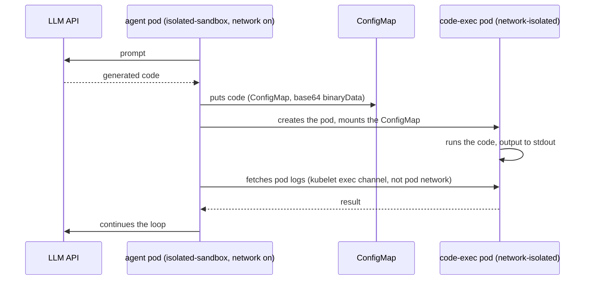

# Running AI-generated code on EKS in Nitro Sandboxes: a hands-on guide

*Author: [Igor Gorovyy](https://www.linkedin.com/in/gorovyyigor/), DevOps Engineer Lead & Senior Solutions Architect, AWS Community Builder*

You let an AI agent write code and run it. That code came out of a model that reads the internet, so you cannot trust it, and a normal container is a weak fence for untrusted code. On November 9, 2026, AWS shipped a stronger one: [Nitro Sandboxes](https://aws.amazon.com/about-aws/whats-new/2026/11/nitro-sandboxes-eks-ecs-ec2/). Each pod runs inside its own small VM, managed by the same Nitro Hypervisor that separates EC2 instances from each other. It works for EKS pods, ECS tasks and standalone EC2, at no extra charge.

This guide covers three things, in this order:

1. What a Nitro Sandbox changes compared to a regular container.
2. How to turn it on for a pod, and how to run agent-generated code in a pod with no network.
3. What it costs in start time and pods per node, measured on a real cluster.

## Why a regular container is not enough

A regular Kubernetes pod runs on runc, the default container runtime. runc isolates the container with Linux namespaces and cgroups, but every container on the node shares one Linux kernel with the host. If the code inside finds a kernel bug, it can escape the container and reach the node, and from there the other pods on it. For code you wrote yourself that risk is usually acceptable. For code a model just generated, it is not.

There are two common ways to put something stronger between the code and the host kernel:

| Runtime | How it isolates | Which kernel the code talks to |
|---|---|---|
| runc (the default) | namespaces and cgroups | the host kernel, shared with every pod on the node |
| [gVisor](https://gvisor.dev) (`runsc`) | intercepts system calls in a user-space process | gVisor's own reimplementation of the Linux kernel, called the Sentry |
| Nitro Sandbox | a hardware VM under the Nitro Hypervisor | its own guest kernel inside the VM |

You can see the difference with `uname -r` inside a pod. On the same `m8i.xlarge` node, my runc pod printed the host kernel `6.18.56`, the Nitro Sandbox pod printed its own guest kernel `6.18.54`, and the gVisor pod printed `4.19.0-gvisor`, which is the Sentry.

With a Nitro Sandbox, an escape from the container lands inside a VM, not on the node. To reach the node it would also have to break the hypervisor, the same boundary AWS relies on between different customers' instances.

Nitro Sandboxes also support attestation, which you can use for secrets. Each sandbox records measurements of what booted inside it (in PCR registers). A KMS key policy with `kms:RecipientAttestation:PCR` conditions can then release a decryption key only to a sandbox whose measurements match. But here is the catch, straight from the docs: without such a key policy (or another external verifier), the measurements are recorded and nobody checks them. If your agent handles credentials, set up that policy.

Before Nitro Sandboxes, the usual way to get a VM per pod was Kata Containers on nested virtualization. That still works, but it has three limits: nested virtualization exists only on 8th-gen Intel instances (c8i/m8i/r8i), it is not available on Graviton, and there is no attestation. Nitro Sandboxes have none of these limits.

## Turning it on for a pod

You need EKS Auto Mode with Kubernetes 1.36 or newer. Then a pod opts in with one line:

```yaml
spec:
  runtimeClassName: isolated-sandbox
```

Everything else in the pod works as usual: Pod Identity, VPC CNI, EBS/EFS/S3 volumes, CloudWatch.

To compare the runtimes I built one cluster with Terraform ([full code in the repo](https://github.com/igorgorovoy/eks-sandboxes)): an Auto Mode cluster with a NodePool pinned to `m8i.xlarge` for sandbox pods, plus a managed node group of the same instance type with gVisor installed. Same hardware for all three runtimes, so the numbers below are comparable.

```yaml
# Auto Mode NodePool for Nitro Sandbox pods
apiVersion: karpenter.sh/v1
kind: NodePool
metadata:
  name: sandbox-nitro
spec:
  template:
    metadata:
      labels: { sandbox-runtime: nitro }
    spec:
      taints:
        - { key: sandbox, value: nitro, effect: NoSchedule }
      requirements:
        - key: eks.amazonaws.com/instance-family
          operator: In
          values: ["m8i"]
```

A pod that runs generated code then looks like this:

```yaml
apiVersion: v1
kind: Pod
metadata:
  name: nitro-codeexec
  annotations:
    sandbox.amazonaws.com/network-isolated: "true"   # no network device at all
spec:
  runtimeClassName: isolated-sandbox
  nodeSelector: { sandbox-runtime: nitro }
  tolerations:
    - { key: sandbox, operator: Equal, value: nitro, effect: NoSchedule }
```

Two things you will run into:

- Isolation is per pod, not per cluster. A pod without `runtimeClassName`, the toleration and the nodeSelector runs on plain runc.
- The `network-isolated` annotation removes the pod's network device entirely: no DNS, no instance metadata (IMDS), no Pod Identity credentials. So HTTP and TCP probes stop working, and such pods can only use exec probes. `kubectl port-forward` does not reach them either. Logs, exec and stats still work, because they go over a separate vsock channel between the node and the VM, not over the pod network.

With `terraform apply` on a default VPC, the whole setup took about 20 minutes: 31 resources, including private subnets, a NAT gateway, the cluster, add-ons and two node groups. Besides the NodePool above, the setup needs a `RuntimeClass` for gVisor and a NodeConfig that installs gVisor on node boot.

To check the setup I ran four test pods. The results matched the table: runc printed the node's kernel, the Nitro Sandbox pod printed its own kernel and exactly the 1 vCPU it requested, the gVisor pod printed the Sentry kernel, and the network-isolated pod saw only the `lo` interface and failed DNS (`wget: bad address`). Full outputs are in the repo, `data/evidence/runtime-evidence.txt`.

## Running generated code: the agent keeps its network, the code gets none

The agent needs network access to call the model API. The code the model generates does not need any network, and it should not have it: no network means it cannot send your data anywhere or download anything. So I put them in two separate pods:

- The **agent pod** runs in a Nitro Sandbox with network on. It talks to the LLM API and the Kubernetes API.
- The **code-exec pod** runs in a Nitro Sandbox with no network device, no Pod Identity and no service account token. It only runs the code and prints the result.

The two pods never talk over the network. The agent passes the code in a ConfigMap and reads the result from the pod logs:



Three implementation details took me the most time:

**A shared emptyDir does not work here.** An emptyDir belongs to one pod, so two pods cannot share it. Putting the agent and the code into two containers of one pod does not help either: the `network-isolated` annotation applies to the whole pod, so the agent would lose its network too. That is why the code goes through the API server as a ConfigMap.

**The code goes into `binaryData` as base64.** Kubernetes mounts a `binaryData` entry as the decoded bytes, so the agent does not have to escape the code for JSON. The agent script has no kubectl or jq inside the sandbox; it calls the Kubernetes REST API with curl, using the service account token and CA certificate that kubelet already mounts. The image is alpine plus `apk add curl`.

**The code-exec pod gets no service account token.** Set `automountServiceAccountToken: false` on it. Then the generated code cannot call the Kubernetes API, create pods or read secrets. The agent's own RBAC is limited to its namespace: create and delete pods and ConfigMaps, read pod logs, nothing else.

The full agent loop is one ConfigMap script and one pod spec; the manifest is [here](https://github.com/igorgorovoy/eks-sandboxes/blob/main/k8s/30-agent-codeexec.yaml). In the demo, the generated code checks its own isolation. It ran in the network-isolated pod and printed:

```
kernel: 6.18.54
interfaces: dummy0 lo
wget: bad address 'aws.amazon.com'
NETWORK: blocked — isolation works
SA token: absent — expected
uid: 0
```

So on a live cluster: the ConfigMap mounts inside the sandbox VM, logs and exec work without a network device, and the code has no service account token.

## What the isolation costs

I measured two things: how long a pod takes to start, and how many pods fit on one `m8i.xlarge` node (4 vCPU, 16 GiB).

**Start time.** The benchmark script creates 10 identical `sleep` pods of one runtime with `kubectl apply`. For each pod it takes the time from pod creation (`creationTimestamp`) to the moment the pod becomes Ready. It also records the total time until all 10 pods are Ready.

I ran this twice. On the first run there were not enough nodes, so some pods waited for EC2 to launch a new node. On the second run the nodes were already there, so it shows the start time of the pod alone.

**Pods per node.** The script creates pods with a 250m CPU request, a 1-vCPU limit and 512 MiB of memory, and waits until the number of Ready pods stops growing.

| | runc | Nitro Sandbox |
|---|---|---|
| Start time, node already running | 0-2 s (10 pods) | 36-38 s for 10 of 11 pods, one pod in 4 s |
| Start time, new node needed | 209 s | 219 s |
| Pods per `m8i.xlarge` | not measured fairly, see below | 15 (memory ran out first) |
| Node cost per pod-hour, packed node | | ~$0.02 |

So the isolation itself costs about 35 seconds per pod start on a node that is already running. One Nitro pod became Ready in 4 s, and I don't know yet why it was so much faster than the others. When a new node is needed, both runtimes wait about 3.5 minutes, and the sandbox adds little to that.

What to know about the other numbers:

- **Pods per node.** The docs set two limits per node, both equal to 5 times the node's vCPU count: the total vCPUs given to all sandboxes, and the number of sandboxes (halved on instance types with CPU overcommit). A 4-vCPU `m8i.xlarge` fits up to 20 single-vCPU sandboxes. Each sandbox pod also uses 256 MiB of memory on top of its request (512 MiB for `confidential-sandbox`), and the scheduler counts it. In my run memory ran out first: 15 pods of 512 MiB plus 256 MiB each filled the 14.4 GiB available to pods, and 5 of the 20 stayed Pending. One more thing from the docs: on instance types with two threads per core (all Intel, most AMD), two different sandboxes never share one physical core, so sandboxed pods get roughly half the advertised vCPUs. Graviton has one thread per core and does not lose anything here.
- **Why no runc and gVisor density numbers.** My runc and gVisor runs ended at 3 and 2 pods per node. That is far below what 250m requests and 16 GiB allow, so these runs hit something else, not a limit of the runtime. I left them out of the comparison; the raw numbers are in the appendix. gVisor has no per-node sandbox caps, so on density it should do better than Nitro.
- **Cost.** ~$0.02 per pod-hour is the `m8i.xlarge` price plus the Auto Mode management fee, divided by 15 pods. Auto Mode charges that fee on top of EC2, and managed node groups do not have it: $0.02831 per hour for an `m8i.xlarge` in eu-west-1 (from the public price list, about 12% of the EC2 price). The NAT gateway for private subnets adds about $0.045 per hour whether there is traffic or not, so delete the demo cluster after your run.

## Measure start time on running nodes and on new nodes separately

A pod's time to Ready consists of two stages, and they have different causes:

1. **Starting the pod on a node that has room.** Image pull, VM boot, guest kernel start. This is the real cost of the isolation: about 37 s for a Nitro Sandbox and 0-2 s for runc in my runs.
2. **Waiting for a node.** If no node has room, Auto Mode asks EC2 for a new one. Booting it and joining it to the cluster takes 1-3 minutes, and the pod waits all that time. In my first run, pods that waited for a node took 209-219 s; the same pods on a running node took 0-38 s. That difference is the node, not the sandbox.

If you mix the two in one number, you get an average that says nothing. Measure them separately.

The second stage can also take much longer for a reason that has nothing to do with sandboxes. My account hit **VcpuLimitExceeded**: a new account can run only 32 on-demand vCPUs per instance family. Seven `m8i.xlarge` nodes (4 vCPUs each) plus the system node filled it. After that every new node request failed with `InsufficientCapacityError`, and pods sat in Pending for about half an hour until I deleted unused nodes. Before you test density, raise this limit or delete the nodeclaims you no longer need.

## Where it does not fit

- No GPU passthrough yet. A Nitro Sandbox runs on Firecracker, which does not pass devices through, so you cannot run a local model inside one. An agent that needs a local model has to call an API instead, or use gVisor, which can use the host GPUs.
- No resize, no snapshot. CPU and memory are fixed when the pod starts. To change them you delete the pod and create a new one. There is also no snapshot, restore or live migration, so an idle agent keeps paying for its resources.
- The agent's own permissions are the real risk. In this setup the generated code has no network, no token and no API access. But the agent pod can create pods in its namespace, and nothing checks the pod specs it creates. For production, add a Pod Security Standards policy on the namespace and an admission policy that checks `runtimeClassName` and blocks hostPath, or move pod creation out of the pod that talks to the model. The demo does not do this.
- Public cluster endpoint. To keep the demo short, the cluster's API endpoint is public with no IP allowlist. For anything that lives longer, restrict it with `endpoint_public_access_cidrs` or turn it off; private access is already on.
- The vsock channel. The docs say it directly: the vsock device used to talk to the VM is accessible to processes inside the VM, and any process on the node with access to the Firecracker vsock socket can connect to ports inside the VM, even for network-isolated pods. This is not a network bypass, but mention it in a security review when you say "no network".

## Takeaways

For agents that run model-written code on EKS today:

1. Nitro Sandboxes give each pod a hardware VM boundary with one line in the pod spec, and they are the only option here with attestation. The price is about 35 s per pod start and at most 5 sandboxes per vCPU.
2. gVisor is still the better choice when you need many pods per node or a GPU.
3. Kata Containers on nested virtualization is now the legacy path. If you already run it, fine. For new work, Nitro Sandboxes do the same job on the same instance types.

The agent pattern above is small enough for one person to own. It is strict enough for a security review once you close the admission gap from the previous section.

All Terraform, manifests, the agent setup and the benchmark script are in [github.com/igorgorovoy/eks-sandboxes](https://github.com/igorgorovoy/eks-sandboxes). The numbers come from `data/benchmark-results.csv` (second run) and `data/bench-pass1-raw.csv` (first run).

## Appendix: raw measurement data

Times are per pod, in seconds, from pod creation to Ready. "Never Ready" means the pod did not become Ready before the script's timeout; in the CSV these rows have a negative value.

Start time, second run (nodes already running):

| runc | Nitro Sandbox | Nitro Sandbox, network-isolated | gVisor |
|---|---|---|---|
| 2, 1, 1, 1, 1, 1, 0, 0, 0, 1 | 4, 36, 36, 37; 3 pods at 1741-1742 (waited for a new node); 3 never Ready | 37, 38, 38, 38, 38, 37, 37; 3 never Ready | 0, 0; 8 never Ready |

Total time for the batch of 10: runc 5 s, Nitro 1802 s and Nitro network-isolated 1808 s (both mostly waiting for nodes, see the vCPU limit above), gVisor 902 s.

Start time, first run (new nodes needed):

- runc: 1, 1, 1, 1, 209, 209, 209, 38, 38, 37. Total 215 s; the pods were spread over 4 nodes, some of which had to launch.
- Nitro Sandbox: 219, 219, 219, 35; 6 never Ready within the 600 s timeout.
- Nitro Sandbox, network-isolated: 39, 37, 37, 37; 6 never Ready within the 600 s timeout.

Pods per node (250m request, 1 vCPU limit, 512 MiB):

| Runtime | Ready per node | Total |
|---|---|---|
| runc | 3, 3, 3, 3 (four nodes) + 1 | 13 of 60 offered |
| Nitro Sandbox | 15 | 15 of 20 offered, 5 Pending |
| gVisor | 2 | 2 of 60 offered |

The runc and gVisor rows are not runtime limits; see "Why no runc and gVisor density numbers" above.

## Sources

- [Sandboxing on Amazon EKS](https://docs.aws.amazon.com/eks/latest/userguide/sandboxing.html): key features, attestation, encrypted images
- [Nitro Sandboxes considerations, EKS](https://docs.aws.amazon.com/eks/latest/userguide/sandboxing-limitations.html): density caps, SMT core scheduling, resize and device limitations
- [Network isolation](https://docs.aws.amazon.com/eks/latest/userguide/sandboxing-network-isolation.html): exec probes, vsock channel behavior
- [Autoscaling with Nitro Sandboxes](https://docs.aws.amazon.com/eks/latest/userguide/autoscaling.html): slot overhead (256/512 MiB), provisioning
- [Setup paths on EKS](https://docs.aws.amazon.com/eks/latest/userguide/sandboxing-isolated-setup.html): Auto Mode vs node groups, K8s >= 1.36
- [Amazon EC2 Nitro Sandboxes](https://docs.aws.amazon.com/AWSEC2/latest/UserGuide/amazon-ec2-nitro-sandboxes.html): instance support (Intel/AMD/Graviton), when to use what
- [gVisor documentation](https://gvisor.dev/docs/)
- [The repo with all files from this guide](https://github.com/igorgorovoy/eks-sandboxes)

<!--
PRE-SUBMIT STATUS (updated Nov 13, after reader feedback):
[x] smoke tests run, kernel evidence in data/evidence/runtime-evidence.txt
[x] custom NodePool hypothesis confirmed (nodeclaims on sandbox-nitro)
[x] coldstart warm numbers: runc 0-2 s, nitro 36-38 s (one 4 s outlier), nitro-net 37-38 s (censored runs documented)
[x] density: nitro 15/node (20-slot docs cap), memory-bound before slots; runc/gVisor runs did not hit a runtime limit, excluded from comparison
[x] E2E agent demo ran live, output quoted in the text
[x] Graviton, attestation KMS PCR, GPU/resize/snapshot claims verified against official docs
[x] gVisor release pinned 20261102.0 (bundle format, gvisor-bin sidecars)
[x] Auto Mode fee confirmed from the public price list: $0.02831/hour per m8i.xlarge (eu-west-1)
[x] repo is public: github.com/igorgorovoy/eks-sandboxes
[x] announcement link inserted (aws.amazon.com/about-aws/whats-new/2026/11/nitro-sandboxes-eks-ecs-ec2/)
[ ] confirm CPU request used in the runc/gVisor density runs
-->
